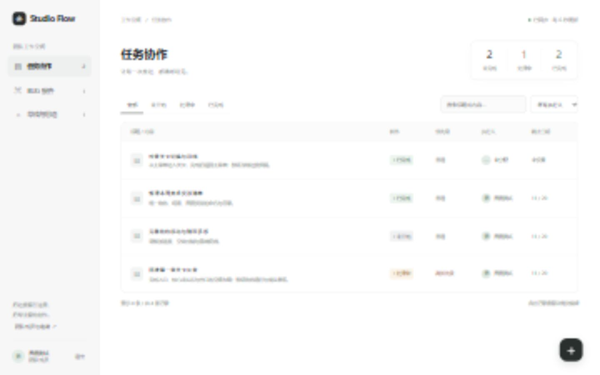

# CKUN STUDIO

<div align="center">

**把进度放在明处，把时间留给游戏。**

为游戏开发小团队打造的轻量协作空间。<br>
任务、BUG、灵感，一处汇集；负责人、状态、截止时间，一眼可见。

[访问网页端](https://ckun.cc/ckunstudio) · [快速开始](#快速开始) · [功能路线图](./制作清单.md) · [Cloudflare 部署](./cloudflare/DEPLOY.md)

`游戏开发协作`　`Godot 团队`　`轻量网页应用`　`Cloudflare 免费测试`

</div>

---

## 从一次真实的开发等待开始

关卡正在调整，敌人配置要等一等；程序修好了问题，测试还不知道；昨天讨论的好点子，又被新的聊天消息淹没。

CKUN STUDIO 诞生于一个 3 人 Godot 团队的日常。我们希望给每项工作一个明确的落点：**这件事是什么、谁在做、做到哪一步、下一步交给谁。**

当前版本已经把任务、问题和灵感汇集到一个可共同访问的网页中。本次 P0 已加入团队管理、预计完成时间、任务依赖、接手通知和个人工作台，完成本地验证，等待发布到网页端。

## 一个工作空间，三条创作主线

| 模块 | 让团队看见什么 |
| --- | --- |
| **任务协作** | 在主页发布任务，由成员自主认领；用标签区分工种，认领后显示执行人与对应颜色；点开查看说明和参考图。 |
| **BUG 报告** | 问题现场、复现步骤、处理负责人和截图，让问题有记录、修复有去向。 |
| **草稿与思路** | 玩法设想、关卡灵感和待验证方案，让想法随时有处安放。 |

统一的列表、搜索、筛选和状态统计，让三个模块保持相同的操作习惯。浅色侧栏、留白布局与微软雅黑字体，让信息清楚、操作安静。



> 当前为可运行的 **MVP**。P0 团队管理与协作闭环已完成实现及本地验证，线上更新需先应用数据库迁移再部署；评论、验收等 P1 功能仍在制作清单中。

## 当前已经能做什么

- **一起使用。** 独立账号登录，通过邀请码加入同一个团队空间。
- **把记录写完整。** 创建、编辑和删除任务、BUG 与思路，补充正文和图片。任务创建只需标题，可选标签、说明和图片，不必分配执行人或填写日期。
- **把进度看清楚。** 显示未完成、处理中和已完成数量，按负责人或状态筛选，搜索标题与内容。
- **减少相互覆盖。** 列表每 6 秒同步；两人同时编辑同一条记录时，版本检测会提醒冲突。
- **留住工作内容。** 数据持久保存，离开未保存的编辑页前会提醒。
- **在网页中协作。** 无需所有成员安装 Godot 插件，使用浏览器即可访问；窄窗口也可操作。

普通成员可按业务规则创建和编辑团队记录，团队管理界面只读。队长可生成限时限次邀请、撤销邀请和移除普通成员；移除后旧会话立即失效，未完成工作改为未分配，历史记录和姓名保留。

主页新增任务广场，可直接发布与认领任务。标签支持“程序、2D贴图、动画、音乐、音效”多选，未认领任务不设执行人；并发认领只有一人成功。每位成员持有固定颜色，认领后显示在任务卡片左侧。任务详情中的进度、优先级、日期和依赖收进“更多设置”，日期仍为选填。

P0 新增：预计完成时间、当前进展、剩余工作与调整原因；阻塞原因、多前置任务及循环依赖检查；任务关注、分配与接手通知、到期提醒、未读及已读状态；汇总任务与 BUG 的个人工作台。前置任务完成仅发送提醒，由负责人确认开始。列表每 6 秒同步，通知最多每分钟检查一次；到期提醒在应用打开时生成。

## 为免费测试准备的云端版本

网页端使用 **Cloudflare Pages Functions + D1**。账号、业务记录和小图附件都保存在 D1，**当前方案无需开通 R2，也无需一直运行本地电脑。**

大图在浏览器内自动缩放并压缩；每条记录最多 5 张图片，每张最多 512KB。附件通过登录接口读取，适合任务参考图和 BUG 截图。原始美术资源与项目文件仍应保存在现有版本管理或素材管理系统中。

Cloudflare 免费额度存在请求、运行时间和存储限制，本项目不承诺无限免费。当前方案用于小团队测试；详细限制和运维说明见 [部署文档](./cloudflare/DEPLOY.md)。

## 快速开始

### 本地体验

安装 **Node.js 24 或更高版本**，然后：

```bash
git clone https://github.com/CKUN22/ckunstudio.git
cd ckunstudio
npm start
```

打开 [http://127.0.0.1:3210](http://127.0.0.1:3210)。Windows 用户也可以双击 `启动协作软件.cmd`。

首次启动创建的账号成为队长，随后在“团队管理”中生成邀请码或分享链接，让其他成员使用自己的密码注册。首次初始化请先在本机完成，再按部署说明对外提供服务。

本地服务与页面不需要安装第三方运行依赖；运行 Cloudflare 工具和完整开发流程时，再使用 `npm ci` 安装开发依赖。

### 云端部署

仓库保留两种运行方式，按需要选择：

| 方式 | 后端与数据 | 图片限制 |
| --- | --- | --- |
| **Cloudflare 免费测试版** | Pages Functions + D1 | 每条最多 5 张，每张 512KB；大图自动压缩 |
| **Node.js 本地 / 自托管版** | Node.js HTTP 服务 + SQLite | 每条最多 5 张，合计不超过 8MB |

Cloudflare 版的接口和资源位于 `/ckunstudio` 路径下，已用于现有 Astro 网站的集成。迁入自己的站点前，请创建自己的数据库和认证密钥，不要复用部署脚本中的项目名或数据库 ID。

- [Cloudflare 网页端部署与首次初始化](./cloudflare/DEPLOY.md)
- [Cloudflare 运行时及上线验证记录](./cloudflare/验证记录.md)
- [本地版验证记录](./验证记录.md)

## 接下来，让“等待”变成清晰的接力

我们希望最终形成这样的协作过程：

> A 更新关卡任务的预计完成时间 → B 看到自己的工作正在等待 A → A 完成前置任务 → B 收到接手提醒 → 团队继续推进。

当前制作状态如下（P0 本次尚未发布）：

| 优先级 | 计划内容 |
| --- | --- |
| **P0 · 已实现并通过本地验证** | 独立团队管理界面；队长邀请、移除成员；普通成员仅查看成员列表；预计完成时间、进度更新、阻塞与依赖、站内通知、我的工作台。 |
| **P1 · 讨论与交付质量** | 评论与 @成员、子任务和检查清单、看板、验收与退回、BUG 复测、活动记录、回收站、队长转让。 |
| **P2 · 游戏开发流程** | 里程碑与版本计划、思路转任务、Godot 资源路径关联、截图标注。 |
| **P3 · 工具集成** | Godot 编辑器插件、可选站外提醒。 |

每一项都有具体制作要求和验收要点，详见 [制作清单.md](./制作清单.md)。P1–P3 仍为规划，不代表当前版本已经支持。

## 项目结构

```text
ckunstudio/
├─ public/                      本地版前端
├─ server.mjs                   Node.js + SQLite 服务
├─ tests/                       本地版集成测试
├─ cloudflare/
│  ├─ site/
│  │  ├─ functions/             Pages Functions 路由入口
│  │  ├─ lib/                   Cloudflare 协作 API
│  │  ├─ migrations/            D1 数据迁移
│  │  └─ public/                云端前端与安全头配置
│  ├─ prepare-site.mjs          从共享前端生成云端资源、集成既有个人站
│  ├─ image-upload.js           免费版图片预处理
│  ├─ smoke.mjs                 本地 Cloudflare 环境完整流程验证
│  └─ DEPLOY.md                 网页端部署说明
└─ 制作清单.md                  分级功能路线图与验收要求
```

## 验证与开发

```bash
# 本地服务集成测试
npm test

# 重新生成 Cloudflare 前端资源
npm run prepare:cloudflare

# 在本地 Cloudflare 模拟服务运行后执行
npm run test:cloudflare -- http://127.0.0.1:8790
node cloudflare/p0-smoke.mjs http://127.0.0.1:8790
```

集成验证覆盖双账号共享、邀请校验、图片访问权限、数据持久化和编辑冲突等关键流程。Cloudflare 测试还覆盖并发初始化、D1 图片存储与大小限制。测试脚本限制只在本机地址运行，不向生产环境写入演示数据。

生产密钥、会话数据、本地数据库和 `.wrangler/` 模拟数据均不应提交到 Git。当前没有自动文件锁定、密码找回和多团队隔离；请根据实际团队需求评估后再扩大使用范围。

---

**从一条清晰的任务开始，让团队一起把游戏做出来。**
